# SRAMBank

**CE391 Lab 3 — Emmett Funston**

Schematic and layout views of an SRAM bank and the circuits that make it up. The bank is built from SRAM cells with precharge, sense amplifier, and write circuitry. These views were captured in Cadence Virtuoso; the verification screenshots come from Calibre.

**[View the design and verification report (PDF)](report/CE391_Lab3_design_and_verification.pdf)**

## SRAM bank

| Schematic | Layout |
| --- | --- |
| [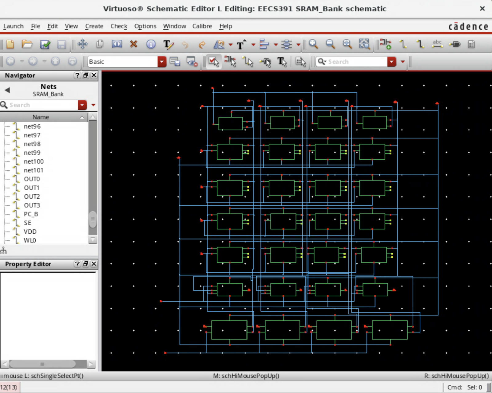](bank/schematic.png) | [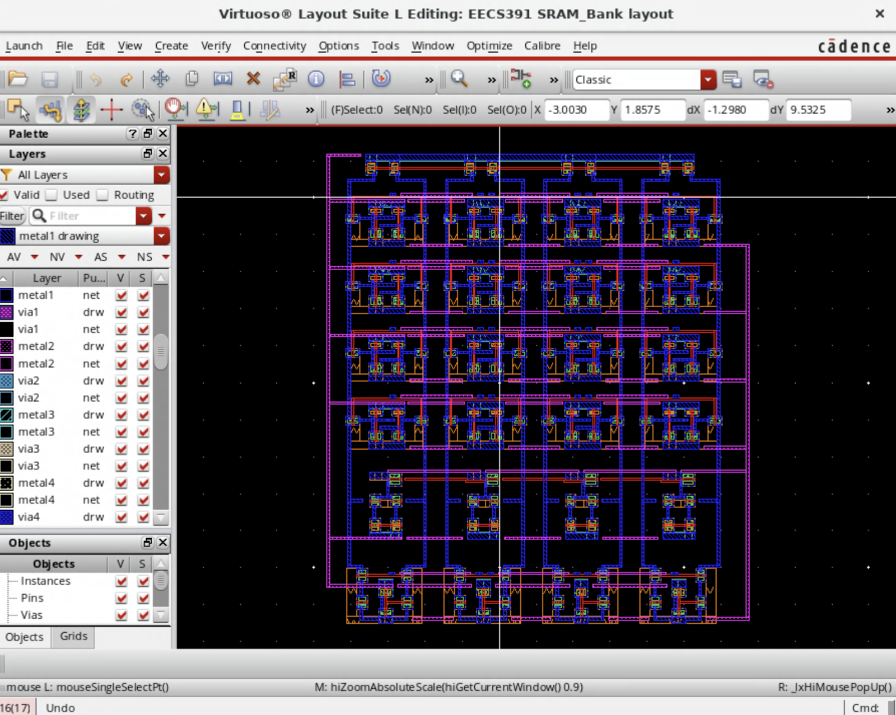](bank/layout.png) |

## Building blocks

### SRAM cell

The six-transistor storage cell uses cross-coupled inverters and word-line-controlled access transistors connected to complementary bit lines.

| Schematic | Layout |
| --- | --- |
| [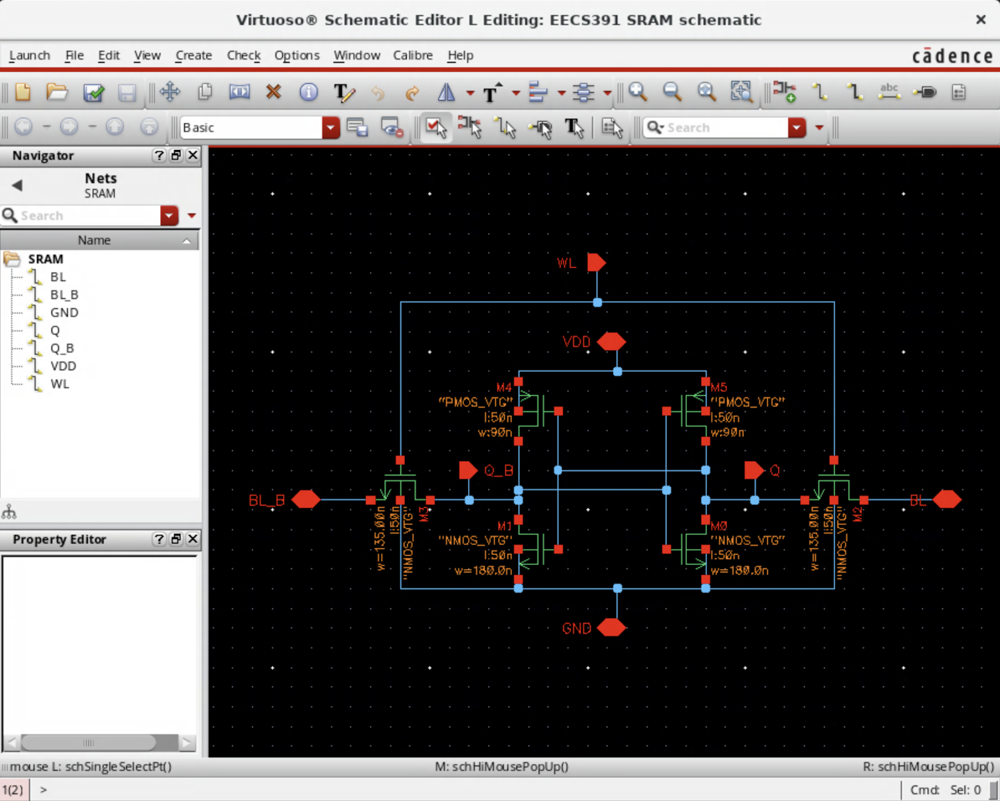](components/cell/schematic.png) | [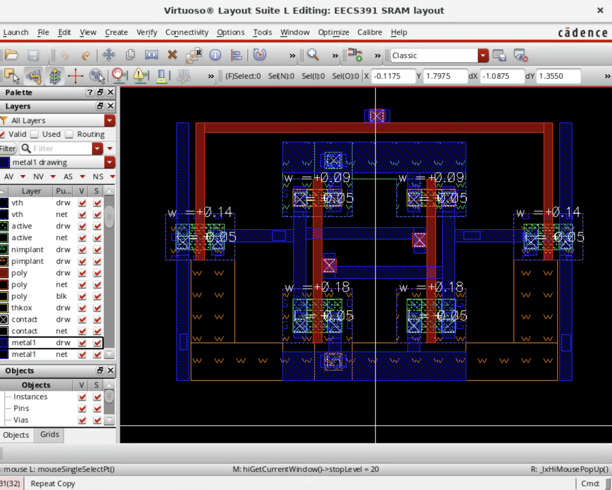](components/cell/layout.png) |

### Precharge

Precharges the complementary bit lines (`BL` and `BL_B`) under the `PC_B` control signal.

| Schematic | Layout |
| --- | --- |
| [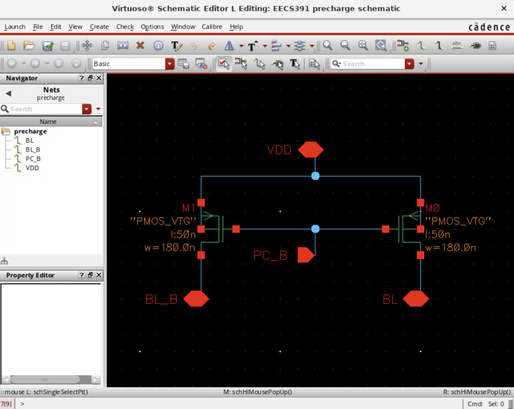](components/precharge/schematic.png) | [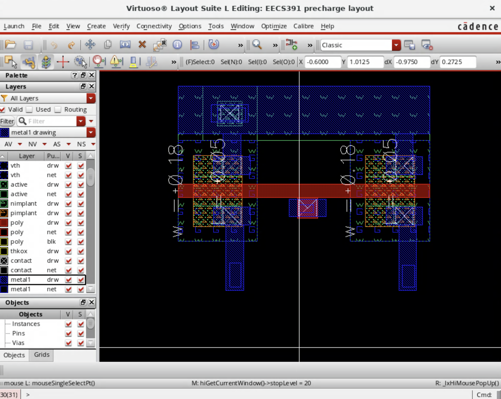](components/precharge/layout.png) |

### Sense amplifier

Reads the differential bit-line pair and drives the `OUT` signal when enabled by `SE`.

| Schematic | Layout |
| --- | --- |
| [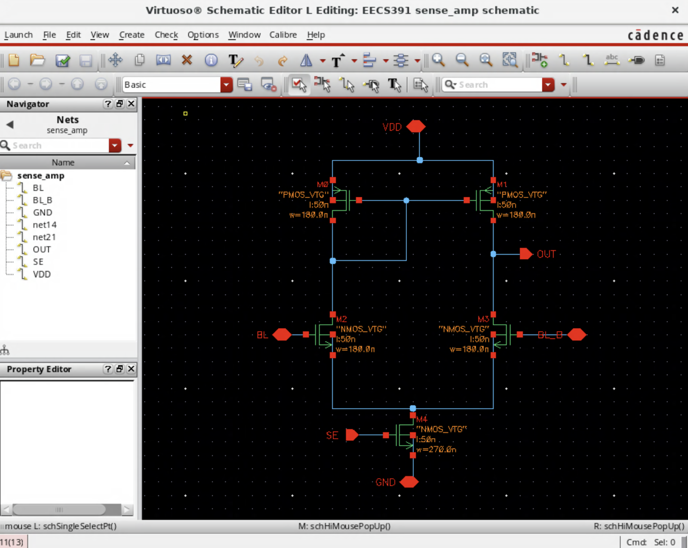](components/sense-amp/schematic.png) | [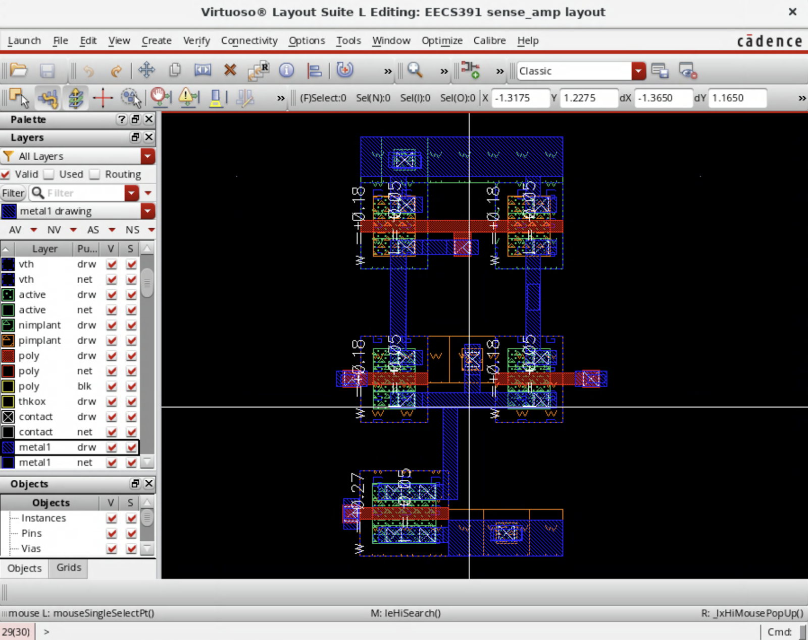](components/sense-amp/layout.png) |

### Write circuit

Drives the complementary bit lines for a write operation from the data and write-control signals shown in the schematic.

| Schematic | Layout |
| --- | --- |
| [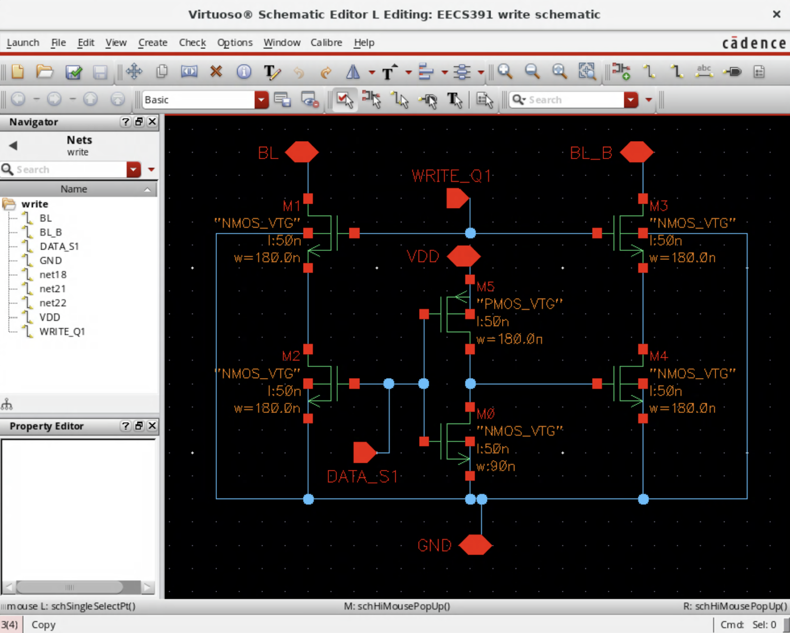](components/write/schematic.png) | [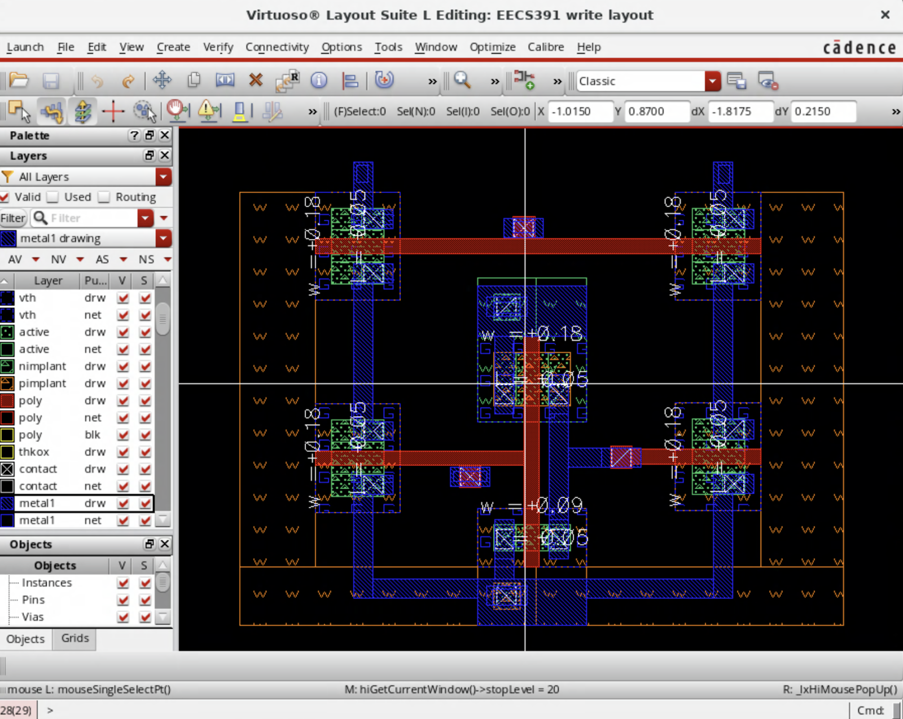](components/write/layout.png) |

## Physical verification

| DRC | LVS |
| --- | --- |
| [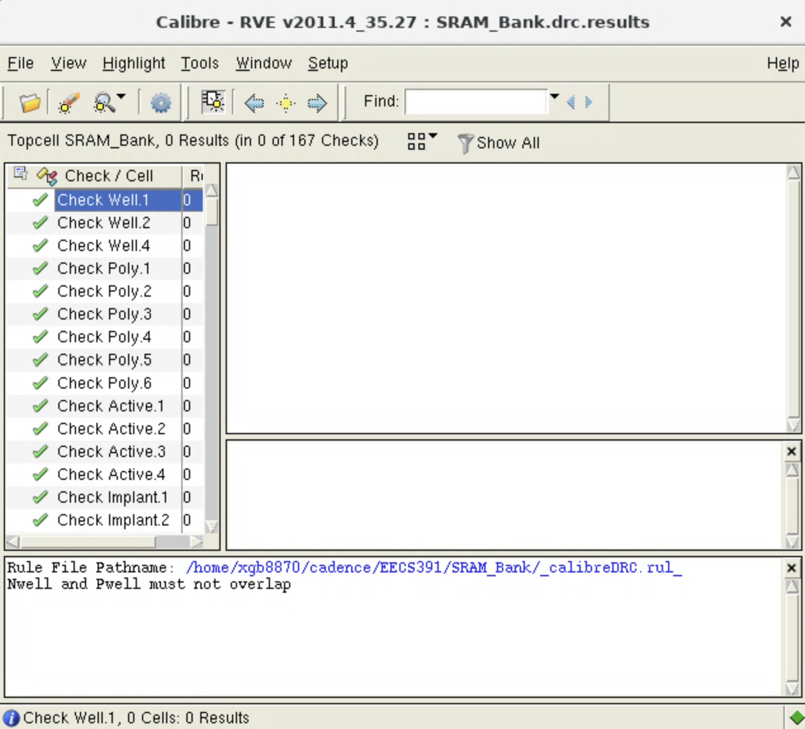](verification/drc.png) | [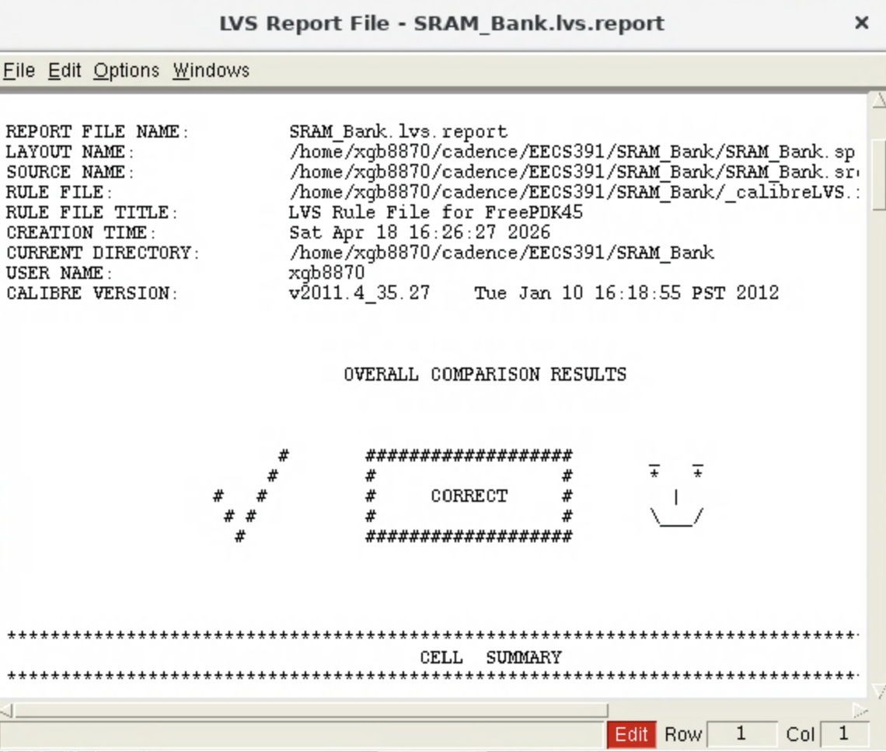](verification/lvs.png) |

The bank DRC screenshot reports **0 results across 167 checks**. The LVS report shows **CORRECT** for the overall comparison.

The PDF and images are selected from the lab report to show the bank, its component schematics and layouts, and physical verification. The screenshots document the design; native Cadence schematic and layout databases are not included.
